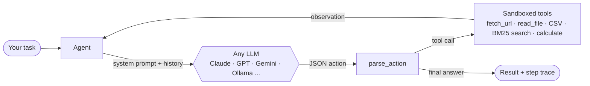

<p align="center">
  
</p>

<h1 align="center">Atomesus Agent Forge</h1>

<p align="center">
  <b>Production-grade AI agent templates on one tiny, model-agnostic core.</b><br>
  Every template runs on Claude, GPT, Gemini, DeepSeek, Groq, OpenRouter or a local Ollama model, without code changes.<br>
  Every template ships with eval cases. Zero dependencies.
</p>

<p align="center">
  <a href="#quick-start">Quick start</a> ·
  <a href="#templates">Templates</a> ·
  <a href="docs/HOW_IT_WORKS.md">How it works</a> ·
  <a href="CONTRIBUTING.md">Add a template</a>
</p>

<p align="center">
  
  
  
  
</p>

---

## Why this exists

Most "awesome AI apps" collections are a pile of demos: every folder uses a different framework, a different UI and a different provider, has its own requirements file, and comes with no way to know if it still works. You clone a repo with 100 projects and end up learning 100 setups.

Agent Forge takes the opposite approach.

|                   | Typical demo collections                 | **Agent Forge**                                                 |
| ----------------- | ---------------------------------------- | --------------------------------------------------------------- |
| Setup             | New `requirements.txt` per project       | `pip install -e .` once, **zero** third-party dependencies      |
| Switching models  | Rewrite the code                         | `--model ollama:llama3.2` or `--model anthropic:claude-sonnet-4-5` |
| Running a project | Different command each time              | `forge run <template> "<task>"` for all of them                 |
| Quality           | "Works on my machine"                    | Eval cases in every manifest, offline tests and CI on every PR  |
| Safety            | Tools can read any file and run anything | Sandboxed file access, AST-only calculator, no `eval` or shell  |
| Learning curve    | One framework per folder                 | One ~200-line agent loop you can read in ten minutes            |
| Adding your own   | Copy a folder and hope                   | `forge new my-agent` scaffolds a manifest, code and README     |

## Quick start

```bash
git clone https://github.com/Ethos6/agent-forge.git
cd agent-forge
pip install -e .

# pick any provider; Forge detects whichever key is set
export ANTHROPIC_API_KEY=...      # or OPENAI_API_KEY / GEMINI_API_KEY / DEEPSEEK_API_KEY / GROQ_API_KEY
# ...or no key at all: Forge falls back to a local Ollama model

forge list
forge run csv-analyst "Which channel drove the most revenue in examples/data/campaigns.csv?" -v
forge run docs-qa "What is the refund window on the Pro plan?"
forge run content-team "Announce our new open-source agent framework" --model gemini:gemini-2.5-flash
```

Use it as a library too:

```python
from forge import Agent, tool, get_llm

@tool
def word_count(text: str) -> int:
    """Count the words in a piece of text."""
    return len(text.split())

agent = Agent("editor", "You are a concise editor.", tools=[word_count], llm=get_llm("openai:gpt-4o-mini"))
print(agent.run("Is this under 20 words? 'Ship small, ship often.'"))
```

## Templates

<!-- catalog:start -->
| Template | What it does | Category | Try it |
|---|---|---|---|
| [**Research Brief Agent**](templates/research-brief) | Reads the pages you give it and writes a cited, executive-ready brief that separates facts from inference. | `research` | `forge run research-brief "Summarize https://en.wikipedia.org/wiki/Large_language_model for a CMO"` |
| [**CSV Analyst Agent**](templates/csv-analyst) | Answers plain-English questions about a CSV with tool-computed numbers only, and shows its working. | `data` | `forge run csv-analyst "Which channel drove the most revenue in examples/data/campaigns.csv?"` |
| [**Docs Q&A Agent (RAG)**](templates/docs-qa) | Chat with any folder of docs. Every claim is cited to file:line, and it refuses when the answer isn't there. | `rag` | `forge run docs-qa "What is the refund window on the Pro plan?"` |
| [**Code Review Agent**](templates/code-reviewer) | Reviews your git diff like a staff engineer: severity-ranked bugs with a trigger scenario and a fix, no style nits. | `engineering` | `forge run code-reviewer "Review my uncommitted changes"` |
| [**Content Team (Strategist, Writer, Editor)**](templates/content-team) | A three-agent pipeline: a strategist writes the brief, a writer drafts the piece, and an editor cuts it to publish-ready copy. | `marketing` | `forge run content-team "Announce our new open-source agent framework to developers"` |
| [**Competitor Watch Agent**](templates/competitor-watch) | Fetches competitor homepages and pricing pages and turns them into a positioning table, gaps, and three concrete moves. | `business` | `forge run competitor-watch "We are https://ourco.com, compare us with https://rival1.com/pricing and https://rival2.com"` |
<!-- catalog:end -->

Every template is a folder with three files: `agent.toml` (metadata and eval cases), `agent.py` (a `build()` function, usually under 40 lines) and `README.md`. The table above is generated from the manifests by `forge catalog`, and CI fails if it falls out of date.

## How it works



1. **One protocol for every model.** Instead of relying on each vendor's function-calling format, the agent asks the model to reply with a single JSON object: `{"tool": ..., "args": ...}` or `{"final": ...}`. Any model that can follow instructions can drive the loop, including small local models.
2. **Forgiving parser.** `parse_action` finds the action even when the model wraps it in prose or code fences.
3. **Tools are plain Python functions.** The `@tool` decorator reads the signature and docstring. Tool errors go back to the model as observations, so it can recover instead of crashing.
4. **Pipelines for teams.** `Pipeline(strategist, writer, editor)` passes each agent the original request plus the previous agent's output.
5. **Evals in the manifest.** `forge eval` runs each `[[evals]]` case against a real model and checks required phrases and time limits, so you can see what a model change actually does to quality.

The full walkthrough is in **[docs/HOW_IT_WORKS.md](docs/HOW_IT_WORKS.md)**.

## Supported models

| Provider     | `--model` / `FORGE_MODEL`              | Key                   |
| ------------ | -------------------------------------- | --------------------- |
| Anthropic    | `anthropic:<model>`                    | `ANTHROPIC_API_KEY`   |
| OpenAI       | `openai:<model>`                       | `OPENAI_API_KEY`      |
| Google       | `gemini:<model>`                       | `GEMINI_API_KEY`      |
| DeepSeek     | `deepseek:<model>`                     | `DEEPSEEK_API_KEY`    |
| Groq         | `groq:<model>`                         | `GROQ_API_KEY`        |
| OpenRouter   | `openrouter:<model>`                   | `OPENROUTER_API_KEY`  |
| Ollama (local) | `ollama:<model>`                     | none                  |
| Any OpenAI-compatible server | `openai:<model>` + `OPENAI_BASE_URL` | your server's key |

## Quality gates

```bash
python -m unittest discover -s tests -v   # offline, no keys needed
forge validate                            # every manifest is complete and every build() works
forge eval                                # run all eval cases against your configured model
```

## Roadmap

- [ ] Streaming output and a token/cost meter per run
- [ ] Optional embeddings backend for `docs-qa`
- [ ] Scheduled "always-on" runner (cron + Slack/email delivery)
- [ ] Web playground for every template
- [ ] Eval leaderboard: the same template across models

## Contributing

New templates are welcome. Run `forge new my-agent`, fill in the three files, then make sure `forge validate` and the tests pass. See [CONTRIBUTING.md](CONTRIBUTING.md).

## License

[MIT](LICENSE) © 2026 Atomesus Team
