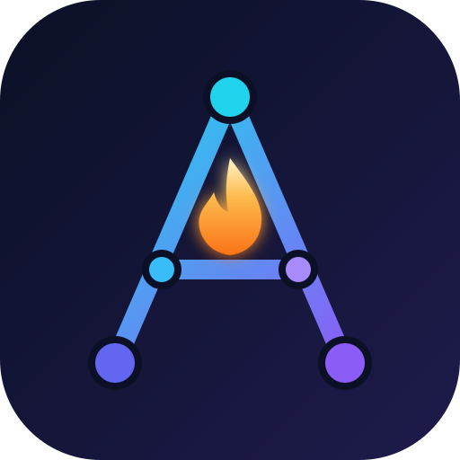

<p align="center">
  
</p>

<h1 align="center">Agent Army</h1>

<p align="center">
  <b>100+ production-grade AI agents on one tiny, model-agnostic core.</b><br>
  Every agent runs on Claude, GPT, Gemini, DeepSeek, Groq, OpenRouter or a local Ollama model, without code changes.<br>
  One command to run any of them. Eval cases in every agent. Zero dependencies.
</p>

<p align="center">
  <a href="#quick-start">Quick start</a> ·
  <a href="#the-army">All agents</a> ·
  <a href="docs/HOW_IT_WORKS.md">How it works</a> ·
  <a href="docs/COURSE.md">Course</a> ·
  <a href="CONTRIBUTING.md">Add an agent</a>
</p>

<p align="center">
  
  
  
  
  <a href="https://github.com/Ethos6/agent-army/actions/workflows/ci.yml"></a>
</p>

---

## Why Agent Army

Most "awesome AI apps" collections are a pile of demos: every folder uses a different framework, a different UI and a different provider, has its own requirements file, and comes with no way to know if it still works. You clone 100 projects and learn 100 setups.

Agent Army is one system:

|                    | Typical demo collections                   | **Agent Army**                                                        |
| ------------------ | ------------------------------------------ | --------------------------------------------------------------------- |
| Setup              | A new `requirements.txt` per project       | `pip install -e .` once, **zero** third-party dependencies            |
| Switching models   | Rewrite the code                           | `--model ollama:llama3.2` or `--model anthropic:claude-sonnet-4-5`    |
| Running an agent   | A different command each time              | `army run <agent> "<task>"` for all 109                               |
| A UI               | A different web app per project            | `army serve`: one playground for every agent                          |
| Scheduling         | Write your own cron + Slack glue           | `army schedule <agent> "<task>" --every 1440 --webhook <url>`         |
| Quality            | "Works on my machine"                      | Eval cases in every agent, offline tests and CI on every change       |
| Safety             | Tools can read any file and run anything   | Sandboxed files, read-only SQL, AST-only calculator, no shell         |
| Coding-agent skills | A separate collection                     | `army export-skill <agent>` turns any agent into a SKILL.md           |
| Learning curve     | One framework per folder                   | One ~250-line agent loop you can read in ten minutes                  |

## Quick start

```bash
git clone https://github.com/Ethos6/agent-army.git
cd agent-army
pip install -e .

# pick any provider; Agent Army detects whichever key is set
export ANTHROPIC_API_KEY=...      # or OPENAI_API_KEY / GEMINI_API_KEY / DEEPSEEK_API_KEY / GROQ_API_KEY
# ...or set no key at all: it falls back to a local Ollama model

army list                                     # all 109 agents by category
army run csv-analyst "Which channel drove the most revenue in examples/data/campaigns.csv?" -v
army run deep-research "When will solid-state EV batteries reach mass production?"
army run legal-team "Review examples/contracts/mutual_nda.md; we are the Recipient"
army run tic-tac-toe-arena "play" --opt x_model=openai:gpt-4o-mini --opt o_model=ollama:llama3.2
army serve                                    # web playground at http://127.0.0.1:8765
```

Use it as a library:

```python
from army import Agent, tool, get_llm
from army.web import web_search

@tool
def word_count(text: str) -> int:
    """Count the words in a piece of text."""
    return len(text.split())

agent = Agent("editor", "You are a concise editor.", tools=[web_search, word_count], llm=get_llm("gemini:gemini-2.5-flash"))
print(agent.run("Find the current tagline of python.org and tell me how many words it has."))
```

## The army

<!-- catalog:start -->
**109 templates in 16 categories.** Full docs: [docs/TEMPLATES.md](docs/TEMPLATES.md)


### Starter agents (14)

| Template | What it does |
|---|---|
| [**Blog to Podcast Script**](templates/starter/blog_to_podcast.py) `blog-to-podcast` | Turns any article URL into a faithful, natural two-host podcast script with timestamps. |
| [**Concept Explainer**](templates/starter/concept_explainer.py) `concept-explainer` | Any concept explained at three depths with an analogy, worked example, misconceptions and a quiz. |
| [**CSV Analyst**](templates/starter/csv_analyst.py) `csv-analyst` | Answers plain-English questions about a CSV with tool-computed numbers only, and shows its working. |
| [**Decision Helper**](templates/starter/decision_helper.py) `decision-helper` | Weighted decision matrix with exact scores, a sensitivity check and the cheapest next test. |
| [**Email Writer**](templates/starter/email_writer.py) `email-writer` | Three strategically different email drafts for any situation, with subject lines and trade-offs. |
| [**Interview Coach**](templates/starter/interview_coach.py) `interview-coach` | Company research, the questions you'll likely get, and what a strong answer must include for each. |
| [**Translator & Localizer**](templates/starter/localizer.py) `localizer` | Native-sounding translation that adapts idioms, units and formality, with a glossary and change log. |
| [**Meal Planner**](templates/starter/meal_planner.py) `meal-planner` | A week of meals that reuse ingredients, plus an aisle-grouped shopping list with exact totals. |
| [**Mixture of Models**](templates/starter/mixture_of_models.py) `mixture-of-models` | Several models answer independently; a judge merges the best parts and flags disagreements. |
| [**Resume Tailor**](templates/starter/resume_tailor.py) `resume-tailor` | Requirement-by-requirement fit score, rewritten bullets from your real experience, and honest gaps. |
| [**Stock Snapshot**](templates/starter/stock_snapshot.py) `stock-snapshot` | Price trend, recent news and the bull/bear case for a ticker, with every number sourced from tools. |
| [**Travel Planner**](templates/starter/travel_planner.py) `travel-planner` | Day-by-day itinerary that uses the live forecast, your budget in local currency, and researched sights. |
| [**Link Summarizer**](templates/starter/url_summarizer.py) `url-summarizer` | TL;DR, key points, numbers and 'should I read it?' for any link or list of links. |
| [**Web Data Extractor**](templates/starter/web_extractor.py) `web-extractor` | Turns any web page into a clean CSV/JSON of the fields you describe, saved to outputs/. |

### Research agents (8)

| Template | What it does |
|---|---|
| [**arXiv Scout**](templates/research/arxiv_scout.py) `arxiv-scout` | Searches arXiv several ways, ranks papers, and explains each one's contribution and limits plainly. |
| [**Deep Research**](templates/research/deep_research.py) `deep-research` | Planner, researcher and writer agents produce a long-form, fully cited report with confidence grades. |
| [**Fact Checker**](templates/research/fact_checker.py) `fact-checker` | Splits text into checkable claims and rates each with evidence for and against, fully sourced. |
| [**Literature Review Matrix**](templates/research/literature_review.py) `literature-review` | A paper-by-paper comparison matrix, synthesis of agreements and conflicts, and research gaps. |
| [**Market Sizer**](templates/research/market_sizer.py) `market-sizer` | TAM/SAM/SOM estimated top-down and bottom-up with every assumption sourced and every sum calculated. |
| [**News Digest**](templates/research/news_digest.py) `news-digest` | Reads your trusted RSS feeds, de-duplicates, ranks by your interests, and writes a 5-minute digest. |
| [**Research Brief**](templates/research/research_brief.py) `research-brief` | Reads the pages you give it and writes a cited, executive-ready brief that separates facts from inference. |
| [**Tech Radar**](templates/research/tech_radar.py) `tech-radar` | Clusters what developers discuss on Hacker News into themes and rates each Adopt/Trial/Assess/Hold. |

### Business & strategy agents (12)

| Template | What it does |
|---|---|
| [**Budget Coach**](templates/business/budget_coach.py) `budget-coach` | Exact spending breakdown from your CSV, the leaks, and a realistic savings and debt plan. |
| [**Competitor Watch**](templates/business/competitor_watch.py) `competitor-watch` | Turns competitor homepages and pricing pages into a positioning table, gaps, and three concrete moves. |
| [**Due Diligence Team**](templates/business/due_diligence_team.py) `due-diligence-team` | Market, product and risk analysts research a startup; a partner writes the investment memo. |
| [**Startup Idea Validator**](templates/business/idea_validator.py) `idea-validator` | Finds competitors and past failures, scores the idea, and designs 2-week kill-or-prove tests. |
| [**Investment Comparison**](templates/business/investment_compare.py) `investment-compare` | Side-by-side performance, news and risks for 2-5 tickers, every number from tools. |
| [**Product Launch Intel**](templates/business/launch_intel.py) `launch-intel` | What a competitor launched, how the market reacted, and the response you should make. |
| [**Meeting Prep**](templates/business/meeting_prep.py) `meeting-prep` | One-page brief before any meeting: their priorities, recent news, talking points and landmines. |
| [**OKR Coach**](templates/business/okr_coach.py) `okr-coach` | Rewrites goals into measurable OKRs, flags vanity metrics, and adds leading indicators. |
| [**Pricing Analyst**](templates/business/pricing_analyst.py) `pricing-analyst` | Competitor price points, value-metric choice, modelled tiers and a validation experiment. |
| [**Customer Review Insights**](templates/business/review_insights.py) `review-insights` | Themes, counts, rating impact and trends from a feedback CSV, turned into a prioritized fix list. |
| [**Sales Battlecard**](templates/business/sales_battlecard.py) `sales-battlecard` | A mid-call battlecard: their pitch, where we win, objection handling and landmine questions. |
| [**Strategy Consultant**](templates/business/strategy_consultant.py) `strategy-consultant` | Issue tree, live market evidence, quantified options and a 30-60-90 plan for any business problem. |

### Marketing & content agents (9)

| Template | What it does |
|---|---|
| [**Ad Copy Variants**](templates/marketing/ad_variants.py) `ad-variants` | Testable ad variants, one angle each, within platform character limits, plus a test plan. |
| [**Brand Voice Checker**](templates/marketing/brand_voice_checker.py) `brand-voice-checker` | Learns your voice from your pages or guide, scores a draft against it, and fixes off-brand lines. |
| [**Content Team**](templates/marketing/content_team.py) `content-team` | Strategist writes the brief, writer drafts, editor cuts it to publish-ready copy with edit notes. |
| [**Landing Page Critic**](templates/marketing/landing_page_critic.py) `landing-page-critic` | Conversion audit of any landing page with scores, rewritten copy and ranked A/B tests. |
| [**Newsletter Writer**](templates/marketing/newsletter_writer.py) `newsletter-writer` | Links or feeds in, a readable newsletter issue out: subject lines, intro, curated items and one CTA. |
| [**Press Release Writer**](templates/marketing/press_release.py) `press-release` | Standard-format press release, a journalist pitch email, and a list of claims that need proof. |
| [**Reader Panel**](templates/marketing/reader_panel.py) `reader-panel` | Three simulated reader personas report where your draft loses them; nothing gets rewritten. |
| [**SEO Content Brief**](templates/marketing/seo_brief.py) `seo-brief` | Search intent, what ranking pages cover and miss, an outline, titles, metas and a unique angle. |
| [**Social Media Calendar**](templates/marketing/social_calendar.py) `social-calendar` | A month of channel-native posts across content pillars, written and saved as an importable CSV. |

### Engineering & coding agents (10)

| Template | What it does |
|---|---|
| [**API Docs Writer**](templates/engineering/api_docs_writer.py) `api-docs-writer` | Generates accurate reference docs with examples from your source code, and flags inconsistencies. |
| [**Architecture Reviewer**](templates/engineering/architecture_reviewer.py) `architecture-reviewer` | Maps a codebase or design doc, finds failure points and risks, and proposes prioritized changes. |
| [**Bug Triage**](templates/engineering/bug_triage.py) `bug-triage` | Turns a bug report or stack trace into ranked root-cause hypotheses, a fix and a regression test. |
| [**Code Reviewer**](templates/engineering/code_reviewer.py) `code-reviewer` | Reviews your git diff like a staff engineer: ranked bugs with a trigger scenario and a fix, no style nits. |
| [**Commit Explainer**](templates/engineering/commit_explainer.py) `commit-explainer` | Reconstructs why a file or code region exists from blame, introducing commits and later edits. |
| [**Dependency Auditor**](templates/engineering/dependency_auditor.py) `dependency-auditor` | Audits requirements.txt against live PyPI: outdated, yanked, obsolete backports, duplicates, unpinned. |
| [**Incident Postmortem Writer**](templates/engineering/postmortem_writer.py) `postmortem-writer` | Raw incident notes in, a blameless postmortem out: impact, timeline, five whys and owned actions. |
| [**Scope Creep Checker**](templates/engineering/scope_checker.py) `scope-checker` | Checks whether a diff grew beyond its stated intent; recommends what to keep, split or justify. |
| [**SQL Assistant**](templates/engineering/sql_assistant.py) `sql-assistant` | Plain-English questions to read-only SQL on SQLite, with the query shown and results sanity-checked. |
| [**Test Writer**](templates/engineering/test_writer.py) `test-writer` | Writes branch-driven unit tests for a source file and saves them, with a coverage map. |

### Multi-agent teams (10)

| Template | What it does |
|---|---|
| [**Debate Panel**](templates/teams/debate_panel.py) `debate-panel` | Advocate and critic argue with evidence; a moderator finds the cruxes and rules. Mix models freely. |
| [**Design Review Panel**](templates/teams/design_review_panel.py) `design-review-panel` | Usability, accessibility and visual experts review a page independently; a lead prioritizes fixes. |
| [**Finance Research Team**](templates/teams/finance_team.py) `finance-team` | A manager delegates to market-data and news analysts, then writes one research note. |
| [**Game Design Team**](templates/teams/game_design_team.py) `game-design-team` | Creative director, systems designer, narrative designer and producer produce a scoped design doc. |
| [**Legal Review Team**](templates/teams/legal_team.py) `legal-team` | Clause analyst, risk analyst and negotiator review a contract and produce redlines and an email. |
| [**Real Estate Team**](templates/teams/real_estate_team.py) `real-estate-team` | Analyst, neighbourhood researcher and advisor rank listings for a buyer with exact cost math. |
| [**Recruiting Team**](templates/teams/recruiting_team.py) `recruiting-team` | Screener, hiring manager and coordinator rank resumes with evidence and plan the interviews. |
| [**Software Agency**](templates/teams/software_agency.py) `software-agency` | PM, architect, estimator and delivery lead turn an idea into a scoped, estimated proposal. |
| [**Teaching Team**](templates/teams/teaching_team.py) `teaching-team` | Curriculum designer, librarian, explainer and assessor build a personal learning path. |
| [**Travel Planning Team**](templates/teams/travel_team.py) `travel-team` | A lead planner delegates to weather, research and budget specialists, then writes the itinerary. |

### RAG (retrieval-augmented generation) (11)

| Template | What it does |
|---|---|
| [**Citation-Checked RAG**](templates/rag/citation_checker.py) `citation-checker` | An answerer cites the docs; a verifier re-checks every citation and strips unsupported claims. |
| [**Corrective RAG**](templates/rag/corrective_rag.py) `corrective-rag` | Grades its own retrieved passages, retries with better queries, and falls back to the web, labelled. |
| [**Docs Q&A**](templates/rag/docs_qa.py) `docs-qa` | Chat with any folder of docs. Every claim is cited to file:line, and it refuses when the answer isn't there. |
| [**FAQ Builder**](templates/rag/faq_builder.py) `faq-builder` | Predicts customer questions, answers them from your docs with citations, and lists content gaps. |
| [**Entity Graph RAG**](templates/rag/graph_rag.py) `graph-rag` | Builds an entity graph over your docs so the agent can answer multi-hop questions with citations. |
| [**Hybrid Search RAG**](templates/rag/hybrid_rag.py) `hybrid-rag` | Keyword + embedding search fused with reciprocal-rank fusion, cited to file:line. |
| [**Multi-Source Router**](templates/rag/multi_source_router.py) `multi-source-router` | Routes each question to the right knowledge base among several, citing source and file:line. |
| [**Query Rewriting RAG**](templates/rag/query_rewrite_rag.py) `query-rewrite-rag` | Decomposes vague or multi-part questions into targeted searches, then answers each part with citations. |
| [**Retrieval Clinic**](templates/rag/retrieval_clinic.py) `retrieval-clinic` | Runs your test questions through retrieval and diagnoses each failure type with a fix. |
| [**Semantic RAG**](templates/rag/semantic_rag.py) `semantic-rag` | Meaning-based retrieval with embeddings, held in memory: no vector database needed. |
| [**Database + Docs Router**](templates/rag/sql_docs_router.py) `sql-docs-router` | Routes each question to read-only SQL, document search, or both, and cites each kind of evidence. |

### Chat with your data (7)

| Template | What it does |
|---|---|
| [**Chat with Your Email**](templates/chat/chat_with_email.py) `chat-with-email` | Ask an .mbox email export about deadlines, invoices and threads, citing sender, date and subject. |
| [**Chat with a GitHub Repo**](templates/chat/chat_with_github.py) `chat-with-github` | Ask about any GitHub repo: structure, where features live, how to run it, recent releases. |
| [**Chat with a Newsletter or Blog**](templates/chat/chat_with_newsletter.py) `chat-with-newsletter` | Ask questions across a newsletter's or blog's archive via its RSS feed, with links to each post. |
| [**Chat with a Research Paper**](templates/chat/chat_with_paper.py) `chat-with-paper` | Discuss any arXiv paper: method, results, assumptions and limits, claims vs evidence. |
| [**Chat with PDF**](templates/chat/chat_with_pdf.py) `chat-with-pdf` | Questions about any PDF answered with page citations; long files are searched, not stuffed. |
| [**Chat with a Video Transcript**](templates/chat/chat_with_transcript.py) `chat-with-transcript` | Q&A, chapters and summaries for any .vtt/.srt transcript, with [mm:ss] timestamps. |
| [**Chat with a Website**](templates/chat/chat_with_website.py) `chat-with-website` | Answers questions about any site by reading its relevant pages, citing the URL for each fact. |

### Agents with long-term memory (5)

| Template | What it does |
|---|---|
| [**Journal Coach**](templates/memory/journal_coach.py) `journal-coach` | A reflective journaling partner that remembers themes across entries and spots patterns over time. |
| [**Personal Assistant with Memory**](templates/memory/personal_assistant.py) `personal-assistant` | Remembers your preferences, projects and goals across sessions in a local, editable memory file. |
| [**Research Tracker with Memory**](templates/memory/research_tracker.py) `research-tracker` | Remembers your research interests and what you've read; every search builds on the last. |
| [**Shared-Memory Duo**](templates/memory/shared_memory_duo.py) `shared-memory-duo` | A planner and an executor, possibly on different models, share one memory of the project. |
| [**Travel Concierge with Memory**](templates/memory/travel_concierge.py) `travel-concierge` | Learns your travel style once and applies it to every future trip, with live weather and rates. |

### MCP (Model Context Protocol) agents (5)

| Template | What it does |
|---|---|
| [**Universal MCP Agent**](templates/mcp/mcp_agent.py) `mcp-agent` | Plug in any MCP server by command; the agent discovers and uses its tools on any model. |
| [**Browser MCP Agent**](templates/mcp/mcp_browser.py) `mcp-browser` | Drives a real browser over MCP for JavaScript-heavy sites; never logs in, pays or accepts terms. |
| [**Filesystem MCP Agent**](templates/mcp/mcp_filesystem.py) `mcp-filesystem` | Search, summarize and organize files in allowed folders through the filesystem MCP server. |
| [**GitHub MCP Agent**](templates/mcp/mcp_github.py) `mcp-github` | Ask about issues, PRs and repos in plain English through the GitHub MCP server. |
| [**Multi-MCP Router**](templates/mcp/mcp_router.py) `mcp-router` | Routes each step to the right one of several MCP servers, which start only when needed. |

### Voice agents (4)

| Template | What it does |
|---|---|
| [**Audio Tour Guide**](templates/voice/audio_tour_guide.py) `audio-tour-guide` | A researched walking tour with one narrated MP3 per stop, tuned to your interests and pace. |
| [**Podcast Generator**](templates/voice/podcast_generator.py) `podcast-generator` | Article or topic in, narrated MP3 episode out: researched script plus text-to-speech. |
| [**Voice Notes to Brief**](templates/voice/voice_notes_brief.py) `voice-notes-brief` | Turns a rambling voice memo into decisions, open questions and actions; inferences clearly marked. |
| [**Voice Support Agent**](templates/voice/voice_support.py) `voice-support` | Transcribes a caller's question, answers from your docs with citations, and replies as audio. |

### Game-playing agents (3)

| Template | What it does |
|---|---|
| [**Connect Four Arena**](templates/games/connect_four_arena.py) `connect-four-arena` | Two models play Connect Four with engine-validated moves and win detection; full game log. |
| [**Tic-Tac-Toe Arena**](templates/games/tic_tac_toe_arena.py) `tic-tac-toe-arena` | Two models play tic-tac-toe with engine-validated moves; full move log and result. |
| [**Twenty Questions**](templates/games/twenty_questions.py) `twenty-questions` | A host model hides a secret; a guesser model narrows it down with 20 yes/no questions. |

### Always-on & scheduled agents (4)

| Template | What it does |
|---|---|
| [**Feed Monitor**](templates/always-on/feed_monitor.py) `feed-monitor` | Hourly-safe feed watcher: alerts only on new items matching your rules, never repeats. |
| [**Daily Hacker News Briefing**](templates/always-on/hn_briefing.py) `hn-briefing` | A scheduled scout: ranks new Hacker News stories for your interests, never repeats one, posts to a webhook. |
| [**Price Watch**](templates/always-on/price_watch.py) `price-watch` | Scheduled price and plan tracker: remembers last values, reports only changes with exact % moves. |
| [**Release Radar**](templates/always-on/release_radar.py) `release-radar` | Watches your dependencies' GitHub releases and flags breaking, security and deprecation changes. |

### Generative UI agents (3)

| Template | What it does |
|---|---|
| [**Dashboard Builder**](templates/ui/dashboard_builder.py) `dashboard-builder` | CSV plus a plain-English description in, a self-contained HTML dashboard with real numbers out. |
| [**Form Builder**](templates/ui/form_builder.py) `form-builder` | Plain-English description to an accessible, validated, self-contained HTML form. |
| [**Landing Page Builder**](templates/ui/landing_page_builder.py) `landing-page-builder` | Product description or URL in, a responsive, conversion-focused single-file landing page out. |

### Cost & context optimization (2)

| Template | What it does |
|---|---|
| [**Context Compressor**](templates/optimize/context_compressor.py) `context-compressor` | Compresses long text into dense, fact-preserving notes and reports the size reduction. |
| [**Prompt Optimizer**](templates/optimize/prompt_optimizer.py) `prompt-optimizer` | Rewrites a prompt, tests original vs candidates on real inputs, and returns the measured winner. |

### Fine-tuning & dataset builders (2)

| Template | What it does |
|---|---|
| [**Fine-tuning Dataset Builder**](templates/finetune/dataset_builder.py) `dataset-builder` | Docs folder to grounded instruction/response pairs in chat JSONL, with a held-out eval split. |
| [**Eval Case Builder**](templates/finetune/eval_builder.py) `eval-builder` | Reads a template's code and writes ready-to-paste EVALS: happy path, edge and must-refuse cases. |
<!-- catalog:end -->

## What's in the box

| Module | What it gives every agent |
| --- | --- |
| `army.llm` | One `chat()` interface over Anthropic, OpenAI, Gemini, DeepSeek, Groq, OpenRouter, Ollama and any OpenAI-compatible server |
| `army.agent` | The agent loop, `@tool`, `Pipeline` (sequential teams), `Panel` (independent answers + judge), `agent_tool` (manager delegates to workers) |
| `army.tools` | Sandboxed files, CSV analytics, read-only SQLite, PDF text, mailbox search, transcripts, git history, exact calculator |
| `army.web` | Web search (Tavily, Brave or keyless DuckDuckGo, with Wikipedia fallback), page fetch, site crawl, RSS, arXiv, Hacker News, GitHub, weather, FX, stock history, PyPI |
| `army.rag` | BM25 keyword search, embeddings (OpenAI, Gemini, Ollama), hybrid fusion, file:line citations |
| `army.memory` | Long-term memory as a local JSON file, shared between agents and models |
| `army.mcp` | A Model Context Protocol client: plug in any MCP server and use it from any model |
| `army.voice` | Speech-to-text and text-to-speech over any OpenAI-compatible audio API |
| `army serve` / `schedule` / `export-skill` | Web playground, always-on runner with webhooks, SKILL.md export |

## How it works


1. **One protocol for every model.** The agent asks the model to reply with one JSON object, either `{"tool": ..., "args": ...}` or `{"final": ...}`, so any instruction-following model can drive it, including small local ones.
2. **Tools are typed Python functions.** Errors go back to the model as observations, so it can recover instead of crashing.
3. **Teams are composition.** `Pipeline`, `Panel` and `agent_tool` cover sequential, parallel-plus-judge and manager-worker patterns.
4. **Evals live next to the code.** `army eval` runs every agent's cases against your model, so you can measure a model switch before you make it.

Full walkthrough: **[docs/HOW_IT_WORKS.md](docs/HOW_IT_WORKS.md)**. Build your own in an afternoon with the **[course](docs/COURSE.md)**.

## Supported models

| Provider | `--model` / `ARMY_MODEL` | Key |
| --- | --- | --- |
| Anthropic | `anthropic:<model>` | `ANTHROPIC_API_KEY` |
| OpenAI | `openai:<model>` | `OPENAI_API_KEY` |
| Google | `gemini:<model>` | `GEMINI_API_KEY` |
| DeepSeek | `deepseek:<model>` | `DEEPSEEK_API_KEY` |
| Groq | `groq:<model>` | `GROQ_API_KEY` |
| OpenRouter | `openrouter:<model>` | `OPENROUTER_API_KEY` |
| Ollama (local) | `ollama:<model>` | none |
| Any OpenAI-compatible server | `openai:<model>` + `OPENAI_BASE_URL` | your server's key |

Optional: `TAVILY_API_KEY` or `BRAVE_API_KEY` for stronger web search, `GITHUB_TOKEN` for GitHub rate limits, `ARMY_EMBED_MODEL` for embeddings.

## Quality gates

```bash
python -m unittest discover -s tests -v   # offline: every agent built and run against a scripted model
army validate                             # every agent has metadata, docs, eval cases and a working build()
army eval --category rag                  # run eval cases against your configured model
```

## Roadmap

- [ ] Streaming output and a per-run token/cost meter
- [ ] Eval leaderboard: every agent across popular models
- [ ] Hosted playground
- [ ] More agents every week: [open an issue](https://github.com/Ethos6/agent-army/issues) to request one

## Contributing

New agents are welcome. Run `army new <category> <name>`, fill in the file, then make sure `army validate` and the tests pass. See [CONTRIBUTING.md](CONTRIBUTING.md).

## License

[MIT](LICENSE) © 2026 Agent Army contributors
